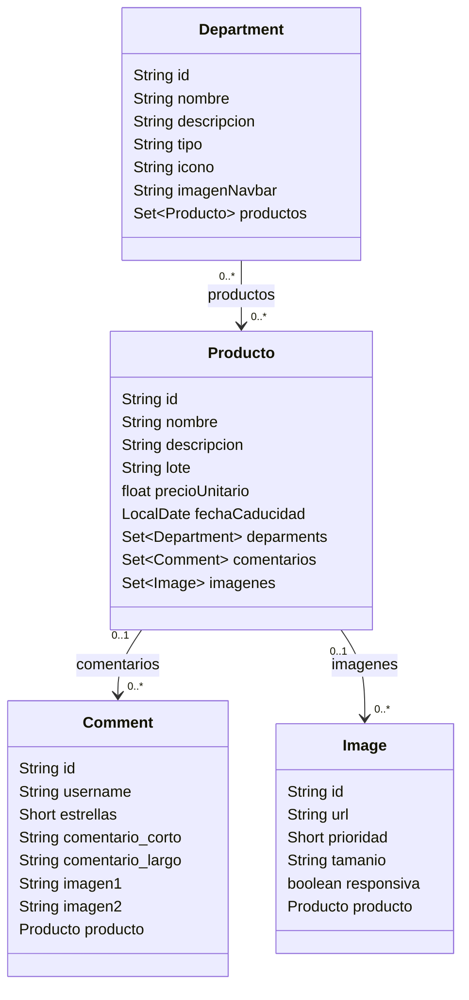

# Spring Many-to-Many

Este proyecto es una pequeña API REST en Spring Boot que demuestra el uso de relaciones entre entidades con JPA/Hibernate y PostgreSQL. El ejemplo principal es una relación muchos a muchos entre `Department` y `Producto`, además de relaciones uno a muchos con `Comment` e `Image`.

## Objetivo

Aprender a:

- crear entidades JPA con relaciones `@ManyToMany`, `@OneToMany` y `@ManyToOne`
- configurar PostgreSQL con Spring Boot
- crear repositorios con Spring Data JPA
- exponer endpoints REST para gestionar recursos
- entender cómo se crea la tabla de unión en una relación muchos a muchos

## Stack

- Java 21
- Spring Boot 3.3.4
- Spring Data JPA
- Hibernate
- PostgreSQL
- Maven

## Requisitos previos

Antes de ejecutar el proyecto necesitas tener instalado:

- Java 21+
- Maven
- PostgreSQL
- Docker (opcional, si quieres levantar la base de datos en contenedor)

## Paso 0: Crear la base de datos

Si aún no existe, crea la base de datos `chochos` en PostgreSQL:

```bash
psql -h db -U postgres -d postgres
```

```sql
CREATE USER chochos WITH PASSWORD 'chochos';
CREATE DATABASE chochos OWNER chochos;
```

Asegúrate de que la configuración de la aplicación apunte a la base correcta:

```properties
spring.datasource.url=jdbc:postgresql://db:5432/chochos
spring.datasource.username=chochos
spring.datasource.password=chochos
spring.jpa.hibernate.ddl-auto=update
spring.jpa.properties.hibernate.dialect=org.hibernate.dialect.PostgreSQLDialect
```

## Paso 1: Crear el modelo `Department`

Crea la entidad `Department` en `demo/src/main/java/com/example/demo/model/Department.java`:

```java
package com.example.demo.model;

import jakarta.persistence.Entity;
import jakarta.persistence.FetchType;
import jakarta.persistence.GeneratedValue;
import jakarta.persistence.GenerationType;
import jakarta.persistence.Id;
import jakarta.persistence.JoinColumn;
import jakarta.persistence.JoinTable;
import jakarta.persistence.ManyToMany;
import jakarta.persistence.Table;
import lombok.AllArgsConstructor;
import lombok.Builder;
import lombok.Getter;
import lombok.NoArgsConstructor;
import lombok.Setter;

import java.util.HashSet;
import java.util.Set;

@Getter
@Builder
@NoArgsConstructor
@AllArgsConstructor
@Table(name = "Categorias")
@Entity
public class Department {
    @Id
    @GeneratedValue(strategy = GenerationType.UUID)
    @Setter
    private String id;

    private String nombre;
    private String descripcion;
    private String tipo;
    private String icono;
    private String imagenNavbar;

    @ManyToMany(fetch = FetchType.EAGER)
    @JoinTable(
            name = "producto_deparments",
            joinColumns = @JoinColumn(name = "deparments_id"),
            inverseJoinColumns = @JoinColumn(name = "product_id")
    )
    @Setter
    private Set<Producto> productos = new HashSet<>();
}
```

### ¿Qué hace esto?

La anotación `@ManyToMany` indica que un `Department` puede estar asociado a muchos `Producto` y viceversa.

La anotación `@JoinTable` le dice a JPA que cree una tabla intermedia para guardar esa relación. En este caso, la tabla de unión sería algo como:

```sql
producto_deparments
- deparments_id
- product_id
```

JPA crea automáticamente esta tabla y la usa para resolver la relación sin guardar ids duplicados en la entidad principal.

## Paso 2: Crear el repositorio

Crea el repositorio `categoriaRepo`:

```java
package com.example.demo.repo;

import com.example.demo.model.Department;
import org.springframework.data.jpa.repository.JpaRepository;

public interface categoriaRepo extends JpaRepository<Department, String> {
}
```

Este repositorio permite hacer operaciones CRUD sobre `Department` usando Spring Data JPA.

## Paso 3: Modificar el modelo principal `Producto`

En `Producto`, agregamos la relación inversa para expresar que un producto puede pertenecer a varias categorías:

```java
@ManyToMany(mappedBy = "productos", fetch = FetchType.EAGER)
@JsonIgnore
@Setter
private Set<Department> deparments = new HashSet<>();
```

### ¿Qué significa `@JsonIgnore`?

`@JsonIgnore` indica a Jackson (la librería que serializa objetos a JSON) que omita este campo en la respuesta HTTP.

Esto ayuda a evitar ciclos de serialización, por ejemplo:

- `Department` tiene muchos `Producto`
- `Producto` tiene muchos `Department`

Si ambos campos se serializan al mismo tiempo, se puede generar un bucle infinito y un JSON muy complejo o incorrecto.

## Paso 4: Diagrama de entidades



La relación entre `Department` y `Producto` se guarda en una tabla intermedia, mientras que las relaciones con comentarios e imágenes se gestionan como asociaciones uno a muchos.

## Paso 5: Crear el controlador

El controlador de categorías debe permitir crear, listar, buscar, actualizar y borrar categorías. Además, debe asociar un producto con una categoría.

```java
package com.example.demo.controllers;

import com.example.demo.model.Department;
import com.example.demo.model.Producto;
import com.example.demo.repo.categoriaRepo;
import com.example.demo.repo.productoRepo;
import org.springframework.beans.factory.annotation.Autowired;
import org.springframework.web.bind.annotation.*;

import java.util.List;
import java.util.Optional;
import java.util.Set;

@RestController
public class CategoriaController {

    @Autowired
    categoriaRepo repo;

    @Autowired
    productoRepo repoProducto;

    @GetMapping("categorias")
    public List<Department> findAllcategoria() {
        return this.repo.findAll();
    }

    @PostMapping("categoria")
    public Department addcategoria(@RequestBody Department categoria) {
        return repo.save(categoria);
    }

    @PostMapping("addProductoCategoria/{productId}/{categoriaId}")
    public Department addcategoria(@PathVariable String productId, @PathVariable String categoriaId) {
        Optional<Producto> p = repoProducto.findById(productId);
        Optional<Department> d = repo.findById(categoriaId);

        if (d.isPresent() && p.isPresent()) {
            d.get().getProductos().add(p.get());
            return repo.save(d.get());
        }

        throw new RuntimeException("Producto o categoría no encontrados");
    }

    @GetMapping("categoria/producto/{productId}")
    public Set<Department> getDepartmentsByProduct(@PathVariable String productId) {
        Optional<Producto> p = repoProducto.findById(productId);
        return p.map(Producto::getDeparments).orElse(null);
    }

    @GetMapping("categoria/{id}")
    public Optional<Department> getById(@PathVariable String id) {
        return repo.findById(id);
    }

    @PutMapping("categoria/{id}")
    public Department putDepartment(@PathVariable String id, @RequestBody Department categoria) {
        categoria.setId(id);
        return repo.save(categoria);
    }

    @DeleteMapping("categoria/{id}")
    public String deleteDeparment(@PathVariable String id) {
        repo.deleteById(id);
        return "{\"success\":true}";
    }
}
```

En este endpoint, el controlador busca primero el producto y la categoría por su id, y luego agrega la relación en la colección del lado dueño de la relación. Esa operación final hace que Hibernate persista el vínculo en la tabla `producto_deparments`.

## Endpoints de la API

La API se ejecuta en `http://localhost:8080`.

| Método | Ruta | Descripción |
|---|---|---|
| `GET` | `/productos` | Lista todos los productos. |
| `POST` | `/producto` | Crea un producto. |
| `GET` | `/producto/{id}` | Busca un producto por id. |
| `PUT` | `/producto/{id}` | Actualiza un producto. |
| `DELETE` | `/producto/{id}` | Elimina un producto. |
| `GET` | `/categorias` | Lista todas las categorías. |
| `POST` | `/categoria` | Crea una categoría. |
| `POST` | `/addProductoCategoria/{productId}/{categoriaId}` | Asocia un producto a una categoría. |
| `GET` | `/categoria/producto/{productId}` | Obtiene las categorías asociadas a un producto. |
| `GET` | `/categoria/{id}` | Busca una categoría por id. |
| `PUT` | `/categoria/{id}` | Actualiza una categoría. |
| `DELETE` | `/categoria/{id}` | Elimina una categoría. |

## Ejemplo de uso con curl

### Crear una categoría

```bash
curl --location 'http://localhost:8080/categoria' \
  --header 'Content-Type: application/json' \
  --data '{
    "nombre": "Tecnologia",
    "descripcion": "Productos electrónicos",
    "tipo": "principal",
    "icono": "cpu",
    "imagenNavbar": "https://example.com/tech.jpg"
  }'
```

### Crear un producto

```bash
curl --location 'http://localhost:8080/producto' \
  --header 'Content-Type: application/json' \
  --data '{
    "nombre": "Laptop",
    "descripcion": "Laptop 15 pulgadas",
    "lote": "LT-2024-01",
    "precioUnitario": 1299.99,
    "fechaCaducidad": "2026-12-31"
  }'
```

### Asociar producto con categoría

```bash
curl --location --request POST 'http://localhost:8080/addProductoCategoria/ID_PRODUCTO/ID_CATEGORIA'
```

### Consultar categorías de un producto

```bash
curl 'http://localhost:8080/categoria/producto/ID_PRODUCTO'
```

## Ejecutar el proyecto

Desde la carpeta `demo`:

```bash
./mvnw spring-boot:run
```

La aplicación queda disponible en:

```text
http://localhost:8080
```

## Observaciones importantes

- `@ManyToMany` genera automáticamente una tabla de unión.
- El lado que contiene `@JoinTable` suele ser el dueño de la relación.
- `mappedBy` indica que el otro lado de la relación no debe gestionar la relación de forma independiente.
- Usa `@JsonIgnore` para evitar ciclos en la serialización JSON.
- Cuando trabajes con fechas, usa el formato ISO: `AAAA-MM-DD`.

## Conclusión

Este ejemplo muestra una base sólida para entender cómo se manejan relaciones complejas con JPA en Spring Boot. La idea clave es que JPA abstrae la gestión de las tablas intermedias y te permite trabajar con colecciones de objetos en lugar de escribir SQL manualmente.

## Paso 4: Probar la aplicación

1. Revisa la base de datos y observa las tablas creadas.

2. Compara las respuestas de tu archivo entregable con los resultados de estas pruebas y, si es necesario, corrígelas.

3. Si todavía no hay productos, crea uno. En la respuesta, guarda el valor de `id`:
```bash
curl --location 'http://localhost:8080/producto' \
--header 'Content-Type: application/json' \
--data '{"nombre":"Proteína de fresa", "descripcion":"2.2 kg", "lote":"123456", "precioUnitario":1500.5, "fechaCaducidad":"2026-05-04"}'
```

4. Crea una categoría:
```bash
curl --location 'http://localhost:8080/categoria' \
--header 'Content-Type: application/json' \
--data '{
    "nombre":"Suplementos",
    "descripcion":"Suplementos alimenticios, vitaminas y productos naturistas",
    "tipo":"Principal",
    "icono":"<i class='\''bi bi-capsule-pill'\''></i>",
    "imagenNavbar":"https://www.google.com/url?sa=t&source=web&rct=j&url=https%3A%2F%2Fnovanaturaclub.com%2Fsuplementacion-en-deportistas%2F%3Fsrsltid%3DAfmBOor8MBqGUZpYp_4gMRgV4IY5ddSt1CRJ9tXQDjSrBdqVlzf_9zcf&ved=0CBUQjRxqFwoTCMDM2YvFrJEDFQAAAAAdAAAAABAH&opi=89978449"
}'
```
5. Crea la relación entre ambos elementos:
> [!CAUTION]
> Sustituye `ID_PRODUCTO` y `ID_CATEGORIA` por los IDs generados en las respuestas anteriores. No incluyas las llaves `{}` en la URL.

```bash
curl --location --request POST 'http://localhost:8080/addProductoCategoria/ID_PRODUCTO/ID_CATEGORIA'
```

6. Revisa la base de datos y verifica que se haya agregado un registro a la tabla `producto_deparments`. También puedes consultar las categorías asociadas al producto:

```bash
curl 'http://localhost:8080/categoria/producto/ID_PRODUCTO'
```
